  

  
  
  
  

## About

Backend developer with **6+ years** of experience, specializing in **Laravel** and **PHP**. I design and build RESTful APIs for workforce management and payroll automation, and have delivered web and Android apps with Laravel back-ends and React Native front-ends for logistics and transportation businesses.

- **Focus** — RESTful APIs, payroll & workforce systems, clean and maintainable back-ends
- **Also** — React Native mobile apps, React / Next.js front-ends
- **Based in** — Makassar, Indonesia · Indonesian & English

## Tech stack

| Area | Technologies |
| :-- | :-- |
| **Backend** |     |
| **Mobile** |   |
| **Frontend** |       |
| **Tools** |   |

## Selected work

| Project | Type | Stack |
| :-- | :-- | :-- |
| **Makole ID** | Android & iOS app + website | Laravel · React Native |
| **Sulawesi Express** | Android app | Laravel · React Native |
| **Merabu Magelang** | Android app | React Native |
| **DBS Indonesia** | Website | ReactJS · Angular |

More details and screenshots on **[sepect.online](https://sepect.online)**.

---

<code>GET /api/v1/profile → 200 OK</code> · Open to collaborations — <a href="mailto:sepect.hzten@gmail.com">say hi</a>

